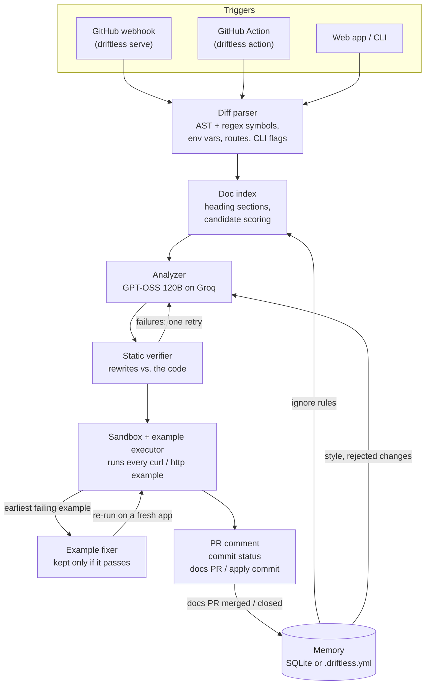

# Driftless

**Docs that never drift.**

*Other tools rewrite your docs. Driftless runs them.*

[](tests/)
[](pyproject.toml)
[](action.yml)
[](https://github.com/marketplace/actions/driftless-docs-check)

🌐 [Live demo](https://driftless-vqms.onrender.com) · 🎥 Demo video *(coming soon)* <!-- TODO: link the demo video --> · ⚡ [GitHub Action](#use-as-a-github-action) · 🛒 [GitHub Marketplace](https://github.com/marketplace/actions/driftless-docs-check) · 📦 [Install](#install)


## The problem

Every merged PR can rename a flag, change a default or reshape a response, and the docs keep describing the old behavior until a confused user files an issue.
Reviewers rarely check docs, and nobody re-runs the `curl` examples in the README after every change.
AI doc tools can rewrite prose, but a rewrite that *reads* right can still be wrong, and nobody checks it.

## What makes Driftless different

| | Typical AI docs tools | Driftless |
|---|:---:|:---:|
| Rewrites the stale doc sections | ✅ | ✅ (only those sections, minimal diff) |
| Verifies every rewrite statically against the code (signatures, symbols, routes, example values) | — | ✅ |
| **Actually runs every documented example** (`curl`, `http`) against the real app | — | ✅ |
| Fixes a broken example and keeps the fix **only if it passes when re-run** | — | ✅ |
| Root-cause tracing: one broken `POST` isn't reported as five broken examples, and knock-on failures are never "fixed" | — | ✅ |
| Blocking **pre-merge** check: one PR comment, a `Driftless / docs-in-sync` commit status, `/driftless apply` | — | ✅ |

## See it in action

The real runs on [`debopamghosh12/driftless-demo`](https://github.com/debopamghosh12/driftless-demo), a small FastAPI notes API whose README and `docs/api.md` are full of `curl` examples:

1. **A PR breaks a documented example.** [PR #8](https://github.com/debopamghosh12/driftless-demo/pull/8) tightens the default note body limit to 3 characters (`app/config.py`). The README's `POST /notes` example no longer works. Driftless (here as the GitHub Action) runs the docs against the app at the PR head, posts one comment saying which example broke and why, proposes the doc fix, and sets `Driftless / docs-in-sync` to failure.
   
2. **`/driftless apply`.** The author replies `/driftless apply`. Driftless commits exactly the fix the comment showed to the PR's branch (`docs: sync docs with this PR`) and replies with the commit link.
   
3. **Green.** The same job re-checks the new head: *✅ Docs are in sync with this PR. Driftless checked 21 doc sections and ran 8 examples across 2 doc files*. The commit status turns green, so the PR can merge. [PR #6](https://github.com/debopamghosh12/driftless-demo/pull/6) shows the same flow run by the webhook server.
   
4. **After a merge: a docs PR.** [PR #3](https://github.com/debopamghosh12/driftless-demo/pull/3) changed `GET /notes` to return a paginated envelope and `DELETE` to return a JSON confirmation. Driftless opened [PR #4](https://github.com/debopamghosh12/driftless-demo/pull/4). It updated 4 sections across 2 files, each with its reason, confidence and ✅ verification, and reported *🧪 Executed examples: 8/8 passing*.
   

## Three ways to use it

### 🌐 Web app

Open the [live demo](https://driftless-vqms.onrender.com), pick `debopamghosh12/driftless-demo`, and press **Run check** to run every documented example, or open a PR and press **Analyze** for a dry run. On the public demo, actions that write to GitHub are admin-only (see [Deploy your own](#deploy-your-own-render)). Run it yourself with `driftless serve` (see [Web app](#web-app)).


### 💻 CLI

```bash
pip install git+https://github.com/debopamghosh12/driftless.git
driftless init                                              # asks for GITHUB_TOKEN and LLM_API_KEY, writes ./.env
driftless doctor --repo owner/name                          # checks secrets, LLM and token permissions
driftless check --repo debopamghosh12/driftless-demo        # run every doc example (--fix opens a PR)
driftless run --repo debopamghosh12/driftless-demo --pr 3 --dry-run   # sync the docs with a merged PR
```

### ⚡ GitHub Action

Nothing to host. Save this as `.github/workflows/driftless.yml` and add a `GROQ_API_KEY` repo secret. The full file, with a weekly audit and concurrency settings, is [`examples/driftless-workflow.yml`](examples/driftless-workflow.yml).

```yaml
name: Driftless
on:
  pull_request:
    types: [opened, synchronize, reopened, ready_for_review, closed]
  issue_comment:
    types: [created]
permissions:
  contents: write
  pull-requests: write
  issues: write
  statuses: write
jobs:
  driftless:
    runs-on: ubuntu-latest
    steps:
      - uses: debopamghosh12/driftless@v1
        with:
          llm-api-key: ${{ secrets.GROQ_API_KEY }}
```

## How it works



1. **Read the change.** The diff between the PR's merge base and its head becomes a ChangeSet: changed functions and classes (Python `ast`, regex for JS/TS), env vars, FastAPI routes and CLI flags.
2. **Find what's stale.** `README.md` and `docs/**/*.md` are split into heading sections and scored against the ChangeSet, so the LLM only sees likely candidates. Ignore rules from memory remove sections up front.
3. **Rewrite only those sections.** One LLM call per doc file (JSON mode, validated with pydantic) returns a verdict and a rewrite for each candidate section. New interfaces that no doc covers get a drafted section, placed next to its siblings.
4. **Verify statically.** Every rewrite is checked against the code at that commit: signatures, symbols, routes, example values, Python blocks, and a minimal diff. A failure gets one retry with the failures attached; what fails twice is dropped.
5. **Run the docs.** The repo's FastAPI app is started in a cached venv with the code's own defaults, and every example runs in document order on a fresh app per file. Failing examples are fixed root cause first; a fix is kept only if it passes when re-run.
6. **Report.** Before the merge: one PR comment, edited in place, plus the commit status, and `/driftless apply` commits the fixes. After the merge: a docs PR explaining every change, or an "in sync" comment. Whether that docs PR is merged or closed is remembered as feedback.

## Build journey

All in 24 hours (Oct 26–27), every step committed. Each entry in [DECISIONS.md](DECISIONS.md) says what was chosen and why.

- **13:45 — DocDrift.** Started as a classic docs bot: parse the merged diff, find stale sections, have the LLM rewrite them, open a docs PR. By 17:49 that worked end to end, with a static verifier, an idempotent docs PR and a webhook server.
- **17:56 — Renamed to Driftless, and pivoted.** Looking around, we saw many projects that do exactly that: an LLM rewrites docs from a diff. A rewrite that *reads* right proves nothing, so the differentiator became **executable docs**: start the real app and run every documented example (18:25). By 19:20 every doc file ran on every sync, since a PR that only changes a status code breaks examples without touching any name the docs mention.
- **20:36 — Pre-merge checks.** Fixing docs after the merge means another PR to review. Catching drift while the PR is open, with a commit status that can block the merge and a `/driftless apply` reply, lets the author fix it in the same change.
- **Then live testing on driftless-demo found the real bugs:**
  - **The sandbox masked code defaults** (#5). The code changed `MAX_BODY_LENGTH`'s default from 1000 to 10, but the sandbox started the app with the docs' `1000`, so the stale example passed. We were configuring the app to agree with the docs under test. Now only variables the code *requires* are set, and every variable it reads is stripped from the host environment.
  - **Knock-on 404s** (#6). One `POST /notes` failed with 422, so the `GET` and `DELETE` of note 1 after it 404'd. The comment said "6 doc sections stale", and the fixer was asked to "fix" the 404s. Now failures are traced to their root cause: only the earliest failing example is fixed, and the ones after it are re-run, not rewritten.
  - **Documenting the error instead of fixing the request** (#7). With the limit set to 2, the fixer "fixed" the `POST` by documenting the 422, and three happy-path examples became error examples. Now three rules are enforced in code, not just in the prompt: a documented 2xx must stay 2xx, a fix is kept only if it passes when re-run, and a 404 after a failed create is a certain knock-on.
  - **`/driftless apply` committed a different fix than the comment showed** (#8, first Actions run). The comment proposed `"Mil"`, but apply ran on a fresh runner, re-ran the LLM and committed `"M"`. Now each check also saves its fixes as a commit, and the comment carries a hidden pointer to it, so apply commits exactly what the reviewer saw. The same run showed a fixed request value (`"Milk"` → `"Tea"`) still echoed in a later response, so echoed values are now updated where the live response confirms them.
- **22:08 → 00:21 — Memory, web app, package and Action.** Per-repo ignore and style rules and feedback from docs PRs, a web app on the same server, `pip install` with `init` and `doctor`, and a GitHub Action with nothing to host.
- **Oct 27 morning — Public demo on Render.** Read-only for visitors, writes behind an admin login, job caps and a per-IP rate limit.

## Install

Requires Python 3.11 or newer. Driftless is a normal Python package with a `driftless` command:

```bash
pip install git+https://github.com/debopamghosh12/driftless.git
# or, isolated from your other tools:
pipx install git+https://github.com/debopamghosh12/driftless.git
```

Then, in the folder you'll run it from:

```bash
driftless init                                  # asks for GITHUB_TOKEN and LLM_API_KEY, writes ./.env
driftless doctor --repo owner/name              # checks everything, prints ✅/❌ and how to fix each
driftless check --repo owner/name               # first run: audit every example in the repo's docs
```

- **Two secrets, nothing else.** `GITHUB_TOKEN` (a token with access to your repos) and `LLM_API_KEY`. The LLM endpoint defaults to Groq (`LLM_BASE_URL=https://api.groq.com/openai/v1`, `LLM_MODEL=openai/gpt-oss-120b`); point both at any OpenAI-compatible endpoint to change it. Settings come from environment variables or a `.env` in the current folder ([`.env.example`](.env.example) lists them all).
- **`driftless init`** asks for both secrets with hidden input and writes them to `./.env`. An existing `.env` is updated in place, other lines are kept, and pressing Enter keeps a value that's already there. It warns if `.env` isn't gitignored. Never commit it.
- **`driftless doctor [--repo owner/name]`** checks the Python version, that the secrets are set (never printing them), that the LLM endpoint answers and serves `LLM_MODEL`, and, with `--repo`, what the token may do there: read contents, and write contents, pull requests, issues and commit statuses (plus reading webhooks, optional). Write access is probed without changing anything: each probe POSTs an empty body, which GitHub rejects with 422 when the token is allowed and 403/404 when it isn't. Every ❌ says how to grant it for a fine-grained token, a classic token, and a workflow's `permissions:`. It exits 1 if a required check fails.

### Development

```bash
# create and activate the virtualenv (Git Bash on Windows)
py -3.11 -m venv .venv
source .venv/Scripts/activate

pip install -e ".[dev]"
cp .env.example .env   # then fill in GITHUB_TOKEN, WEBHOOK_SECRET, LLM_API_KEY
driftless --help
pytest
```

## Usage

Sync the docs with a merged PR (no webhook needed):

```bash
driftless run --repo debopamghosh12/driftless-demo --pr 1            # opens/updates the docs PR
driftless run --repo debopamghosh12/driftless-demo --pr 1 --dry-run  # only print the proposed diff
```

This prints the PR's ChangeSet (changed symbols, env vars, routes, CLI flags), the doc sections most likely to be stale, the LLM's verified rewrites and new sections, and a diff. Without `--dry-run` it then pushes one commit to `driftless/pr-<n>` and opens (or updates) a PR titled `docs: sync docs with #<n> (...)`, printing its URL. If there is nothing to change, it comments on the source PR instead. `GITHUB_TOKEN` needs contents and pull-request write access.

## Executable docs

Driftless doesn't stop at reading the code: it **runs your docs**. Every request example in the docs is executed against the real app, started from the repo at the commit being documented, and an example only counts as correct if it actually works.

- **Examples** are `curl` commands in `bash`/`sh`/`shell`/`console` blocks, or raw requests in `http` blocks (`POST /notes` + headers + JSON body), aimed at `localhost`. Each is paired with its documented result: the first status with a reason phrase that follows it (`200 OK`, `HTTP/1.1 404 Not Found`) and the JSON block after that status. Examples that use shell variables (`$TOKEN`) or other hosts are skipped.
- **The app** is found with `ast` (a module-level `app = FastAPI(...)`, `src/` layouts included) and started with uvicorn on a free port. Its dependencies go into a venv cached under `.driftless_cache/venvs/`, keyed by a hash of `requirements.txt` and the Python version (built with `uv` when available, else `venv` + pip), so only the first run installs anything. **Code defaults are never overridden:** only env vars the code requires without a default (`os.environ["X"]`, pydantic-settings fields with no default) are set, to the value the docs document or else a typed placeholder. Every variable the code reads is removed from the inherited host environment. A doc that says `MAX_BODY_LENGTH` defaults to `1000` while the code says `10` therefore fails when run instead of being papered over.
- **Order matters, state doesn't leak.** Each doc file gets a fresh app, and its examples run in document order, so the `POST` that creates note 1 is what the later `GET /notes/1` reads.
- **Comparison.** The status must match. Documented JSON must match the actual JSON in structure: the same keys and the same value types. Ids and timestamps may differ freely. Other value differences (`"Pen"` vs `"Ink"`, 2 items vs 0) are warnings, not failures, since they usually reflect state rather than wrong docs.
- **Fixing, root causes first.** The LLM gets the *earliest* failing example: the example, its documented result, the actual request and response, and the route code. It fixes the request or the documented response, and the whole file is re-run on a fresh app (up to 2 fixes per example). The fix is then tidied deterministically: ids and timestamps from the live run are put back to the documented values, and unchanged JSON keeps its original formatting. When a fix changes a value in the request body (`"Milk"` → `"Tea"`), every documented response in the same file that echoes it is updated too: a field is changed only if it has the same key, the docs show the old value, and the live response with the fixed request returns the new one, and the file is run again to confirm. Later examples that pass after that re-run failed only because of the earlier one (a `POST /notes` rejected with 422 makes the `GET /notes/1` after it 404), so they are never "fixed" themselves. If the earliest failing example can't be fixed, the failures after it are left alone too, since they may be knock-ons. Each example ends up as **🧪 passed**, **🔁 fixed after running**, **⛓️ failed only because of an earlier example**, or **❌ still failing**. A failing example's doc change is kept, but flagged clearly in the PR.

In `driftless run` and in webhook syncs this happens after the static verifier, on **every** doc file (as the rewrites leave it), even when static analysis finds nothing stale. A PR that only changes runtime behavior, like a status code or a response field, breaks examples without touching any name the docs mention. Any example fixed after running goes into the docs PR, so such a PR still gets one. If examples fail and can't be fixed, and nothing else changed, the source PR gets a comment listing them instead of an "in sync" comment. The docs PR gets a "🧪 Executed examples: X/Y passing" section with a table (file, example, expected vs actual status, result) and lists every example fixed after running. Pass `--no-execute` (or set `EXECUTE_EXAMPLES=false`) to skip it.

### Docs health audit

`driftless check` runs every example in a repo's docs and needs no PR. You can point it at any repo with a FastAPI app:

```bash
driftless check --repo debopamghosh12/driftless-demo    # pass/fail report for main
driftless check --repo owner/name --ref v1.2.0           # any branch, tag or commit
driftless check --repo owner/name --fix                  # fix broken examples, open a PR
```

It exits with status 1 if any example is still failing, so it can gate CI. With `--fix`, the repaired files are committed to `driftless/fix-examples` and a PR is opened (or updated on reruns). As with docs PRs, a file that changed on the default branch since `--ref` is never overwritten.

> **Security note.** Executable docs **run the repository's code on your machine**: its `requirements.txt` is installed and its app is started. Only code someone with write access put in the repository is ever run: a branch, tag or default-branch commit, a merged PR, or a same-repo PR whose author has write access. Never a fork's code. Requirements are installed from wheels only (plain `package==version` lines; no `-r`, URLs or paths). The app is a subprocess bound to `127.0.0.1` with an allow-listed environment (never your credentials), and its process tree is always killed afterwards. In the Docker image it also runs as an unprivileged `sandbox` user that can't read the server's secrets. See [SECURITY.md](SECURITY.md) for the threat model and the residual risks.

## Running as a GitHub webhook

Driftless can run always-on: every merged PR on a watched repo triggers the same sync as `driftless run` (analyze, rewrite, verify, open/update the docs PR). For local development, [smee.io](https://smee.io) forwards GitHub's webhook deliveries to your machine (Windows + Git Bash with Node installed).

1. **Set a webhook secret.** Put a random string in `.env` as `WEBHOOK_SECRET` (e.g. from `python -c "import secrets; print(secrets.token_hex(32))"`). `GITHUB_TOKEN` and `LLM_API_KEY` must be set too. Without a secret the server rejects every delivery.
2. **Start the server** (terminal 1):
   ```bash
   source .venv/Scripts/activate
   driftless serve            # http://127.0.0.1:8000
   ```
3. **Create a smee channel.** Open <https://smee.io> and click **Start a new channel**; copy its URL (`https://smee.io/<id>`).
4. **Forward the channel to the server** (terminal 2):
   ```bash
   npx smee-client --url https://smee.io/<id> --target http://localhost:8000/webhook
   ```
5. **Add the webhook on GitHub.** In the watched repo: **Settings → Webhooks → Add webhook**:
   - **Payload URL:** your smee URL (`https://smee.io/<id>`)
   - **Content type:** `application/json`
   - **Secret:** the same value as `WEBHOOK_SECRET`
   - **Which events?** *Let me select individual events* → tick **Pull requests** and **Issue comments** (untick *Pushes*)
   - **Active:** checked → **Add webhook**
6. **Check it.** GitHub sends a `ping` right away; the server log shows `POST /webhook 200`, and the webhook's *Recent Deliveries* tab shows a green tick. Merge a PR and watch the job:
   ```bash
   curl http://localhost:8000/runs     # last 20 jobs: status, timing, docs PR URL or error
   curl http://localhost:8000/health
   ```

How the server behaves:

- `POST /webhook` verifies `X-Hub-Signature-256` (HMAC-SHA256 of the raw body with `WEBHOOK_SECRET`) and returns **401** if it doesn't match.
- `ping` returns `ok`. `pull_request` with `action=closed` and `merged=true` queues a background **post-merge** sync and returns **202** immediately. `opened`, `synchronize`, `reopened` and `ready_for_review` queue a **pre-merge** check of the pushed head commit, an `issue_comment` whose first line is `/driftless apply` on an open PR queues an **apply** job (see [Pre-merge checks](#pre-merge-checks)), and `/driftless ignore|unignore|style|unstyle|memory ...` queues a **memory** job (see [Memory](#memory)). When one of Driftless's own docs PRs is closed, its changes are remembered as accepted (merged) or rejected (closed without merging). Other PRs closed without merging, drafts, other events on PRs from `driftless/` branches (Driftless's own, plus `docdrift/` branches from before the rename), other comments and other events are acknowledged with `ignored`.
- A PR is never synced twice at the same time: a redelivery while its job is queued or running returns `already running` with the existing job. A newer push, or the merge, **supersedes** a running pre-merge check instead (the response names the superseded job).
- Each job's start, finish, URL (docs PR, comment or commit) or error is logged; `GET /runs` returns the last 20 jobs from SQLite (they survive restarts), each with its `mode` (`pre-merge`, `post-merge`, `apply` or `memory`), the checked `head_sha`, the commit status it set (`check_state`) and, if it was replaced, `superseded_by`.

## Pre-merge checks

Driftless catches doc drift while the PR is still open, so the author fixes the docs before merging rather than in a follow-up PR.

- **What runs.** On `opened`, `synchronize`, `reopened` and `ready_for_review` (drafts are skipped until they're ready), Driftless runs the same analysis as after a merge, but at the PR's **head commit**: docs and code are read there, the verifier checks rewrites against that code, and the executed examples run against the app started from that commit. Doc edits the PR already makes count, so a PR that updates its own docs comes back green.
- **One comment, edited in place.** Driftless posts a single comment (found again by a hidden `<!-- driftless:pre-merge=N -->` marker) and edits it on every push. It says either **✅ Docs are in sync with this PR** (with what was checked: *N doc sections, M examples*) or what the PR breaks, e.g. **⚠️ This PR breaks 1 documented example (`POST /notes`) in 2 files** followed by *4 later examples failed as a result and pass once it's fixed.* Broken examples are counted by root cause; the knock-on failures are listed in a collapsed section. Then come a table of stale sections (file, section, why, the proposed fix and its verification), the proposed doc diff per file in collapsed blocks, the 🧪 executed-examples results, and *Reply `/driftless apply` to commit these doc fixes to this branch.* when there is something to apply.
- **Commit status.** The head SHA gets a status with context `Driftless / docs-in-sync`: `pending` while the check runs, `success` when the docs are in sync, and `failure` when there are stale sections or failing examples, with the counts in the description (e.g. `2 stale doc sections, 1 broken example (POST /notes)`). It links to the comment. If the check crashes, or an LLM review errors and nothing else was found, the status is `error` rather than a false green. Make it a required check in branch protection to block merging stale docs.
- **`/driftless apply`.** A comment that is exactly `/driftless apply` commits the verified fixes from the comment, as one commit on top of the PR's current head, directly to the PR's branch, and replies with the commit link. That push triggers `synchronize`, so the next check reports ✅ and turns the status green. Only users with **write** access (write, maintain or admin) can apply, and only to branches in the same repo: fork branches are refused with a reply saying why. If the branch moved since the comment, Driftless re-checks the new head before committing, and the push is a fast-forward, so a concurrent push is never overwritten.
- **Pre-existing drift isn't the PR's fault.** When the head has failing or fixed examples, Driftless also runs the docs at the PR's base commit (its merge base) against the app started from that commit. Examples that already failed there are *pre-existing drift*: they appear in a collapsed **Already stale on main, not caused by this PR** section, are marked *(pre-existing)* in the examples table, and don't count toward the failing status. Stale sections get the same treatment when it can be decided deterministically: the section is unchanged since the base, and every verifier problem in it that names something the PR touched was already a problem against the base code. Their fixes stay in the diff, so `/driftless apply` cleans them up too. Only drift the PR introduces turns the status red.
- **Newer pushes win.** A push while a check is still running supersedes it: the old job stops at its next checkpoint without commenting, and `/runs` shows it as `superseded`.
- **At merge time.** The post-merge sync still runs. If the docs were fixed before merging, it finds nothing stale and only comments that the docs are in sync (noting they were updated in the PR); no empty docs PR is opened.

The token needs **Commit statuses: write**, **Pull requests: write** and **Contents: write** (to push `/driftless apply` commits). Subscribe the webhook to **Pull requests** and **Issue comments**.

## Memory

Driftless learns per repo. (As a GitHub Action, the rules live in [`.driftless.yml`](#configuration-driftlessyml) instead.) Everything lives in one SQLite file (`DATABASE_URL`, default `sqlite:///driftless.db`) and is keyed by `owner/name`, so nothing leaks between repos.

**Commands.** Comment on any PR of the watched repo. Like `/driftless apply`, every command needs write access (checked with the collaborator-permission API) and gets a short reply:

| Comment | Effect |
|---------|--------|
| `/driftless ignore <file or heading>` | Adds an ignore rule. A file (`CHANGELOG.md`), folder (`docs/legacy/`) or glob (`docs/*.md`) matches by path; anything else matches a heading, case-insensitively, and covers its subsections (`Legacy API`). |
| `/driftless unignore <file or heading>` | Removes that rule. |
| `/driftless style <note>` | Stores a style preference, e.g. `use British spelling` or `keep examples minimal`. |
| `/driftless unstyle <n>` | Removes preference number `n`. |
| `/driftless memory` | Replies with the ignore rules, the numbered style preferences, and the docs-PR feedback. |

The command goes on the comment's first line. Quotes or backticks around the argument are dropped. Commands work on closed PRs too, since they change the repo's memory, not the PR.

**What the memory changes.**

- **Ignore rules** keep matching sections out of candidate selection, so they are never reviewed or rewritten. Files they match get no new sections, and their examples aren't run, in pre-merge and post-merge runs and at the base commit.
- **Style preferences** go into every review, retry and new-section prompt as *Maintainer style preferences for this repo*.
- **Feedback.** When Driftless opens or updates a docs PR, it saves the PR's changes (each rewritten or added section with a short diff and the model's reason, plus fixed examples). When that docs PR is **merged**, they are stored as accepted; when it's **closed without merging**, as rejected. The 3 most recent rejected changes go into the prompts under *Changes the maintainers rejected before*, telling the model not to propose the same kind of change again unless the code clearly requires it.
- **🧠 Remembered for this repo.** When an ignore rule kept something out of a run, or the model was given style preferences or rejected changes, the pre-merge comment, the docs PR body and the in-sync comment say so in one line, e.g. *🧠 Remembered for this repo: applied 1 ignore rule (`CHANGELOG.md`) · followed 2 style preferences.* An ignore rule only counts as applied if it removed a section that would otherwise have been reviewed, or a file with examples.
- **Job history.** Every webhook job is saved on each state change, so `GET /runs` survives restarts. Jobs a previous process left queued or running are marked `failed` with *interrupted: the server restarted before this job finished*.

## Use as a GitHub Action

Any repo can run Driftless in its own GitHub Actions, with nothing to host: no server, no webhook, no database.

It's published on the GitHub Marketplace as **[Driftless Docs Check](https://github.com/marketplace/actions/driftless-docs-check)**. The first release is [v1.0.0](https://github.com/debopamghosh12/driftless/releases/tag/v1.0.0). Use `debopamghosh12/driftless@v1` to get every v1.x update, or `@v1.0.0` to pin this exact release.

1. **Copy the workflow.** Save [`examples/driftless-workflow.yml`](examples/driftless-workflow.yml) as `.github/workflows/driftless.yml` in your repo. It uses `debopamghosh12/driftless@v1`, triggers on pull requests, PR comments, a manual dispatch and a weekly schedule, and grants `contents`, `pull-requests`, `issues` and `statuses` write.
2. **Add the LLM key as a secret.** Get a Groq API key at <https://console.groq.com/keys>, then in your repo: **Settings → Secrets and variables → Actions → New repository secret**, name `GROQ_API_KEY`. The workflow's own `GITHUB_TOKEN` is used for GitHub, so no other secret is needed.
3. **Let it open PRs.** **Settings → Actions → General → Workflow permissions →** tick *Allow GitHub Actions to create and approve pull requests*, so the post-merge docs PR (and `fix` audits) can be opened.
4. **Optional: block merging stale docs.** Under branch protection, make `Driftless / docs-in-sync` (the commit status) or the workflow's job a required check.

What runs on each event (the same routing as the webhook server, in `driftless/events.py`):

| Event | What Driftless does |
|-------|---------------------|
| `pull_request` opened / synchronize / reopened / ready_for_review | [Pre-merge check](#pre-merge-checks): one PR comment, edited in place, and the `Driftless / docs-in-sync` status. With `fail-on-drift` (default) the job fails too when there is drift. Drafts and PRs from forks are skipped (fork PRs get no secrets and a read-only token). |
| `issue_comment` `/driftless apply` | Commits the fixes to the PR's branch. Pushes made with `GITHUB_TOKEN` start no new workflow runs, so the same job then re-checks the new head and updates the comment and status. |
| `issue_comment` `/driftless ignore`, `unignore`, `style`, `unstyle`, `memory` | Replies with the exact `.driftless.yml` change to make (see below), because a runner forgets everything when the job ends. |
| `pull_request` closed + merged | Post-merge sync: opens or updates the docs PR, or comments that the docs are in sync. |
| `workflow_dispatch` / `schedule` | [Docs health audit](#docs-health-audit) of the ref (`driftless check`). With the `fix` input, broken examples are fixed and a PR is opened. |

Inputs of the action:

| Input | Default | |
|-------|---------|---|
| `llm-api-key` | (required) | API key for the LLM endpoint, e.g. `${{ secrets.GROQ_API_KEY }}`. |
| `llm-base-url` | `https://api.groq.com/openai/v1` | Any OpenAI-compatible endpoint. |
| `llm-model` | `openai/gpt-oss-120b` | |
| `github-token` | `${{ github.token }}` | Needs the four write permissions above. |
| `fail-on-drift` | `true` | Exit 1 when a pre-merge check or audit finds drift, so the job can block merges. |
| `fix` | `false` | Audits: fix broken examples and open a PR. |
| `execute-examples` | `true` | Run the documented examples against the app. This runs the repo's code on the runner. |
| `python-version` | `3.11` | |

Outputs: `result` (what ran), `check-state` (`success`, `failure` or `error`) and `url` (the comment, PR or commit). Each run also writes a line to the job summary. `driftless action` is the command behind it: it reads `GITHUB_EVENT_NAME` and the payload at `GITHUB_EVENT_PATH`, so it can be tried locally with a saved payload.

## Configuration (.driftless.yml)

In Action mode, a repo's [memory](#memory) is a file instead of a database. Put `.driftless.yml` at the repo root:

```yaml
ignore:            # never review or rewrite these, and don't run their examples
  - CHANGELOG.md   # a file
  - docs/legacy/   # a folder
  - docs/*.md      # a glob
  - Legacy API     # a heading (case-insensitive), with its subsections
style:             # given to the model with every rewrite
  - Use British spelling.
  - Keep examples minimal.
```

Both keys are optional, and the rules mean the same as `/driftless ignore` and `/driftless style`. The file is read from the **default branch**, so a PR can't loosen the rules it's checked against. A malformed file fails the run with a message saying what's wrong. Commenting `/driftless ignore CHANGELOG.md` on a PR still works: Driftless replies with the whole file as it should read, the new line marked `# new`, ready to commit. Docs-PR feedback (accepted/rejected changes) isn't kept in Action mode, since nothing persists between runs. The webhook server (`driftless serve`) keeps using SQLite and the PR-comment commands.

## Web app

Everything above also works from the browser, with no CLI. `driftless serve` serves the web app from the same process as the webhook, at <http://127.0.0.1:8000/>.


1. **Enable repos.** The web app acts with the server's `GITHUB_TOKEN`, so it only serves repos listed in `ALLOWED_REPOS` (comma-separated, `owner/name` or `owner/*`, e.g. `ALLOWED_REPOS=debopamghosh12/*`). Other repos get a "not enabled on this instance" page. If the list is empty, the web app serves no repo; the webhook is unaffected.
2. **Open a repo.** Type `owner/repo` on the home page. The dashboard shows the repo, its doc files (`README.md`, `docs/**/*.md`), its last runs, and five tabs:
   - **Docs health.** **Run check** is `driftless check` for any branch, tag or commit. It runs as a background job, and the page shows live stages (fetching repo, starting app, running examples, with the file being run) and then the results table (file, example, expected vs. actual status, 🧪/🔁/⛓️/❌). If examples fail, **Fix broken examples (open PR)** does what `check --fix` does and links the PR.
   - **Pull requests.** Recent open and merged PRs. **Analyze** is a dry run. On an open PR it is the pre-merge check at the head, base-commit classification included; on a merged PR it is the post-merge sync at the merge commit. It shows the stale-sections table with verification statuses, the colored doc diff and the executed examples, and posts nothing. The publish buttons queue the same jobs as the webhook. **Post pre-merge check** posts the one PR comment and sets the commit status. **Apply fixes to branch** is `/driftless apply`, run as the token's account (write access, same-repo branches only). **Open docs PR** runs on merged PRs. Each shows the resulting GitHub link. A publish within 30 minutes reuses the dry run instead of calling the LLM again, if the PR's head and the repo's memory haven't changed.
   - **Memory.** Ignore rules and style preferences with add/remove forms. They use the same storage and the same validation as the `/driftless` commands. The tab also shows the docs-PR feedback counts and the rejected changes shown to the model.
   - **Activity.** The repo's job history from SQLite (mode, PR or ref, status, duration, links, errors), refreshed every 3 seconds.
   - **Setup.** Whether `GITHUB_TOKEN`, `WEBHOOK_SECRET` and `LLM_API_KEY` are set (never their values), and whether a webhook delivers pull requests and issue comments as JSON. **Connect webhook** creates one for a public payload URL you enter (e.g. a smee channel), signed with `WEBHOOK_SECRET`. The token needs **Webhooks: read and write**. If GitHub refuses, the manual steps from [Running as a GitHub webhook](#running-as-a-github-webhook) are shown instead.

Long runs are always background jobs in the webhook's job store, so a request never waits on the LLM or the sandbox. A second **Run check** of the same ref while one is running shows that run instead of starting another. Pages never show secrets: payload URLs show only their host, and job errors are scrubbed of the token, webhook secret, LLM key and admin token. All repo content is HTML-escaped. Form posts from another origin are refused, so a page elsewhere can't start runs on your server. `EXECUTE_EXAMPLES=false` disables **Run check**, and the security note under [Docs health audit](#docs-health-audit) applies here too.

## Deploy your own (Render)

The repo ships a `Dockerfile` (python:3.11-slim, `driftless serve` on `0.0.0.0` and the port in `PORT`, default 8000) and a `render.yaml` blueprint for one web service on Render's free plan, set up as a **public demo**.

1. On Render: **New → Blueprint**, pick your fork of this repo. Render reads `render.yaml` and asks once for the secrets: `GITHUB_TOKEN`, `LLM_API_KEY`, `WEBHOOK_SECRET` and `ADMIN_TOKEN` (any long random string, e.g. `python -c "import secrets; print(secrets.token_urlsafe(32))"`).
2. Change `ALLOWED_REPOS` (default `debopamghosh12/*`) and `FEATURED_REPOS` (home-page shortcuts) to your repos. Render health-checks `GET /health`.
3. Open the service URL. For a webhook, use `https://<service>.onrender.com/webhook` as the payload URL (Setup tab → **Connect webhook**, after logging in as admin).

To try the image locally: `docker build -t driftless . && docker run --rm -p 8000:8000 --env-file .env -e PUBLIC_DEMO=true -e ADMIN_TOKEN=<token> driftless`.

**Public demo mode** (`PUBLIC_DEMO=true`). Anyone can browse every tab and run the read-only jobs: **Run check** and **Analyze**. Everything that writes to GitHub (**Open docs PR**, **Post pre-merge check**, **Apply fixes to branch**, **Fix broken examples**, **Connect webhook**, memory add/remove) needs an admin session. Those buttons show 🔒, disabled, with the tooltip "Admin only on the public demo", and the server refuses the request (403) whatever the UI shows. **Admin** in the header asks for `ADMIN_TOKEN` (compared in constant time). It sets a signed, HttpOnly, Secure, SameSite=Lax cookie for 12 hours. Changing `ADMIN_TOKEN` logs everyone out, and with no `ADMIN_TOKEN` nobody can log in. Failed logins are limited to 5 per IP per 10 minutes. A banner on every page says it's a demo and links to [Install](#install) and the [GitHub Action](#use-as-a-github-action). Webhook deliveries are unaffected: they're authenticated by their HMAC signature.

**Abuse limits** (demo only, all configurable): at most 1 running job per repo (`DEMO_MAX_JOBS_PER_REPO`) and 2 in total (`DEMO_MAX_JOBS`), admins included. Visitors may also start at most 5 jobs per IP per 10 minutes (`DEMO_RATE_LIMIT`, `DEMO_RATE_WINDOW_S`). Re-opening a run that's already going never counts. The client IP is the last `X-Forwarded-For` entry (`CLIENT_IP_HEADER`), the one Render's proxy adds, so a client can't spoof it. When a limit is hit, the page says which limit and when to try again.

**Small host.** The blueprint uses modest timeouts: `SANDBOX_STARTUP_TIMEOUT=25` for the app under test to answer, `SANDBOX_INSTALL_TIMEOUT=240` to build its venv, and `EXAMPLE_REQUEST_TIMEOUT=5` per documented request. Everything runtime lives under `/tmp`: the venv cache (`/tmp/driftless_cache`, built with `uv`), the uv cache, and SQLite at `/tmp/driftless.db`. Each job's snapshot directory is deleted when the job ends, and the app's process tree is killed. Render's disk is ephemeral, so **run history, memory rules and cached venvs reset on every redeploy or restart**; the first check after one rebuilds the venv. On the free plan the service also sleeps when idle, and the first request (or webhook delivery) wakes it in about a minute. For durable memory, use the [GitHub Action](#use-as-a-github-action) with `.driftless.yml`, or a host with a persistent disk.

## Security notes

Full threat model, protections and residual risks: [SECURITY.md](SECURITY.md).

- **Executable docs run the repository's code**, but only code from someone with write access: never a fork PR's head or a fork commit, in any mode. See the [security note](#docs-health-audit) above.
- **Webhooks** are accepted only with a valid `X-Hub-Signature-256` (HMAC-SHA256 with `WEBHOOK_SECRET`). Without a secret, every delivery is rejected.
- **Writes need write access.** `/driftless apply` and the memory commands check the commenter's permission with the collaborator API, and apply only fast-forwards same-repo branches.
- **The web app** serves only `ALLOWED_REPOS`, HTML-escapes all repo content, never shows secrets (errors and `/runs` are scrubbed of the token, webhook secret, LLM key and admin token), refuses cross-site form posts, and sends CSP, frame and HSTS headers. On the [public demo](#deploy-your-own-render), every write to GitHub needs an admin session.
- **Secrets** come from the environment or a gitignored `.env`, never from the repo.

## Limitations

- Executable docs need a **FastAPI** app (a module-level `app = FastAPI(...)`) and examples written as `curl` in shell blocks or raw `http` blocks aimed at `localhost`. Examples with shell variables (`$TOKEN`) or other hosts are skipped.
- Symbol extraction is exact for Python (`ast`) and regex-based for JS/TS.
- The sandbox is a subprocess (an unprivileged user in Docker), not a container: it has network access. See [SECURITY.md](SECURITY.md).
- The LLM is paced to Groq's free tier (8000 tokens/minute), so a large PR takes a while.
- In Action mode nothing persists between runs: memory lives in `.driftless.yml`, and docs-PR feedback isn't kept. On the free Render plan, history and memory reset on every redeploy.
- The pre-merge result is a commit status, not a Checks API run, so a personal token is enough. It has no annotations.

## Future work

- Run the app under test in a container with no network or host access.
- Executable examples for more frameworks than FastAPI, and for other example styles (Python client snippets, CLI sessions).
- Durable memory for hosted deployments (a persistent volume or a hosted database).

## Decision log

Every real design decision, with what we chose and why, is in **[DECISIONS.md](DECISIONS.md)** (43 entries, in order).
